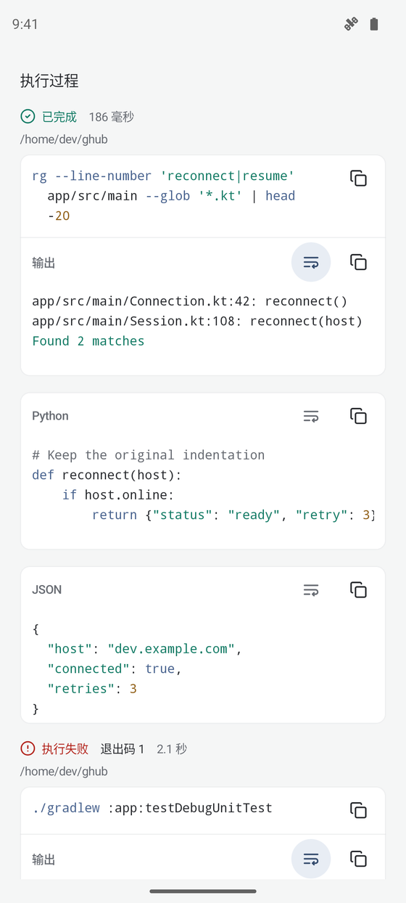
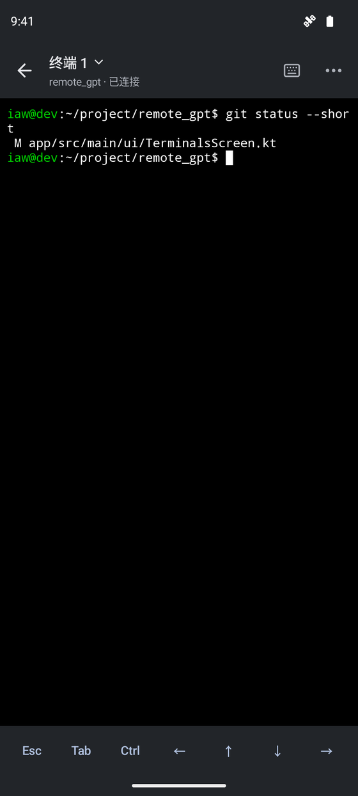
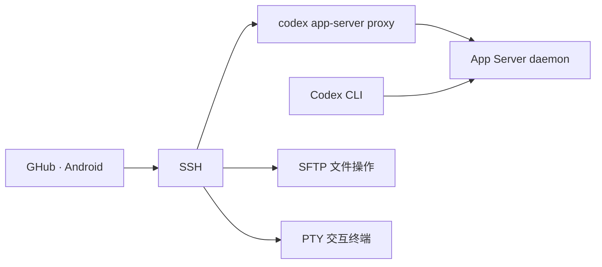

# GHub

在 Android 手机上继续你的 Codex 工作。

GHub 通过 SSH 连接 Linux 开发机，让你在手机上查看会话、发送任务、回答提问、处理审批、编辑文件和操作终端。电脑与手机共享远端 Codex App Server 中的会话。

[](https://github.com/iawnix/GHub/releases/latest)
[](LICENSE)
[](docs/getting-started.md)

[下载 APK](https://github.com/iawnix/GHub/releases/latest) · [版本更新](https://github.com/iawnix/GHub/releases) · [快速开始](docs/getting-started.md) · [文档](docs/README.md) · [参与贡献](CONTRIBUTING.md)

## 功能

- **会话工作台**：按服务器和项目组织会话，支持新建、归档、历史记录、模型与思考级别选择。
- **任务与审批**：接收流式回复，查看执行过程、命令输出和文件改动，在手机上回答交互提问、处理命令与文件审批；待处理请求滚出视野时提供查看入口。
- **代码阅读**：Markdown、语法高亮、Diff、自动换行和全屏阅读，命令与输出可分别复制。
- **远程文件**：通过 SFTP 浏览、上传、下载、预览图片和编辑文本，保存时检查远端修改。
- **交互终端**：支持 Vim、tmux、多个终端、组合键、双指缩放和横屏输入。
- **连接与输入**：多级 SSH 跳板、密钥与密码认证、断线重连、本地草稿、图片附件和系统语音输入。
- **Android 原生界面**：Kotlin、Jetpack Compose、Material 3，支持中文、English 和深浅色主题。

## 界面预览

<p>
  
  
</p>

截图来自 v0.1.42 的离线组件预览，使用示例内容。

## 快速开始

需要 Android 10 或更新版本，以及可通过 SSH 访问、已安装 Codex CLI **0.164.0 或更新的 0.x 版本**的 Linux 主机。

1. 从 [Releases](https://github.com/iawnix/GHub/releases/latest) 下载并安装 `ghub.apk`。
2. 在开发机完成 Codex 登录或模型提供方配置，启动 App Server：

   ```sh
   codex app-server daemon bootstrap
   codex app-server daemon version
   ```

3. 在 GHub 的「设置 → 服务器」中添加 SSH 连接，核对主机指纹后连接。
4. 选择项目，打开已有会话或新建会话。

电脑端使用 `codex --remote unix://` 连接同一用户的默认 daemon，即可与手机接续同一会话。多级跳板、Codex 路径和连接排障见[使用指南](docs/getting-started.md)。

## 工作方式



任务在开发机上运行，手机负责交互和状态同步。SSH 凭据在本机通过 Android Keystore 加密保存；诊断由用户主动导出。连接恢复与后台行为见[连接与同步](docs/connection-recovery.md)。

## 从源码构建

准备 JDK 21、Android SDK Platform 36 和 Build Tools 35.0.0，在 Android Studio 打开项目，或运行：

```sh
git clone https://github.com/iawnix/GHub.git
cd GHub
./gradlew -PpreviewApplicationId=dev.remotegpt.preview :app:assembleDebug
```

APK 位于 `app/build/outputs/apk/debug/app-debug.apk`。预览包可与正式版共存。环境配置、模块结构和界面预览入口见[开发指南](docs/development.md)。

## 参与贡献

欢迎通过 [Issues](https://github.com/iawnix/GHub/issues) 反馈问题或讨论功能，也欢迎改进代码、文档和翻译。提交前请阅读[贡献指南](CONTRIBUTING.md)。

## 许可证

GHub 使用 [GPL-3.0-only](LICENSE) 许可证。终端组件基于 [Termux](https://github.com/termux/termux-app)，完整依赖声明见 [THIRD_PARTY_NOTICES.md](THIRD_PARTY_NOTICES.md)。

GHub 是社区项目，与 OpenAI 无隶属关系。
